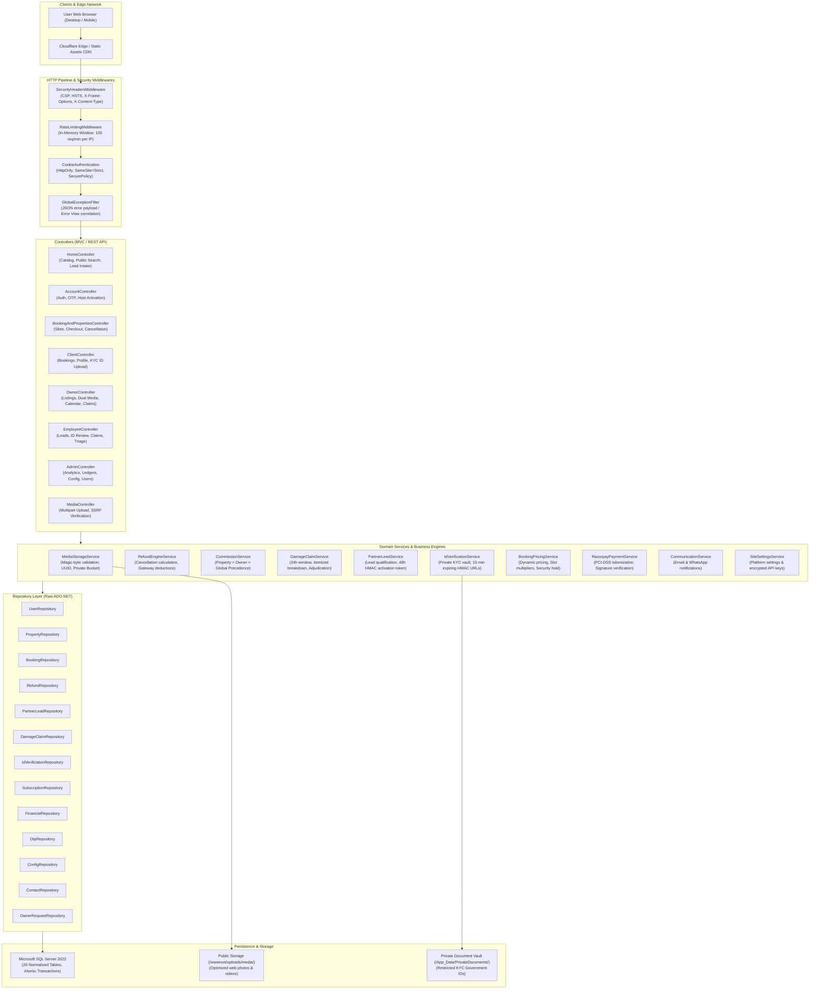
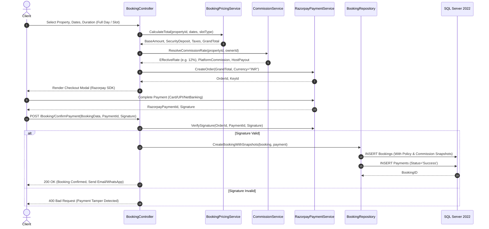
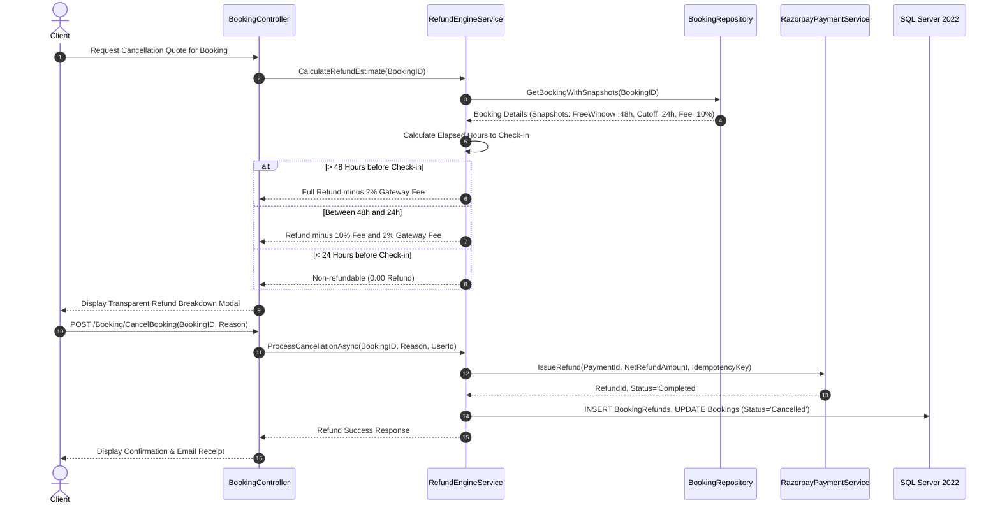
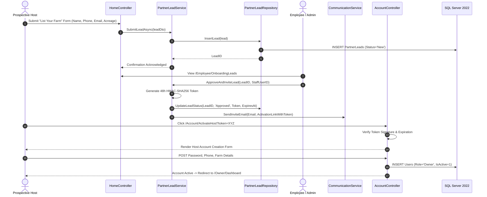
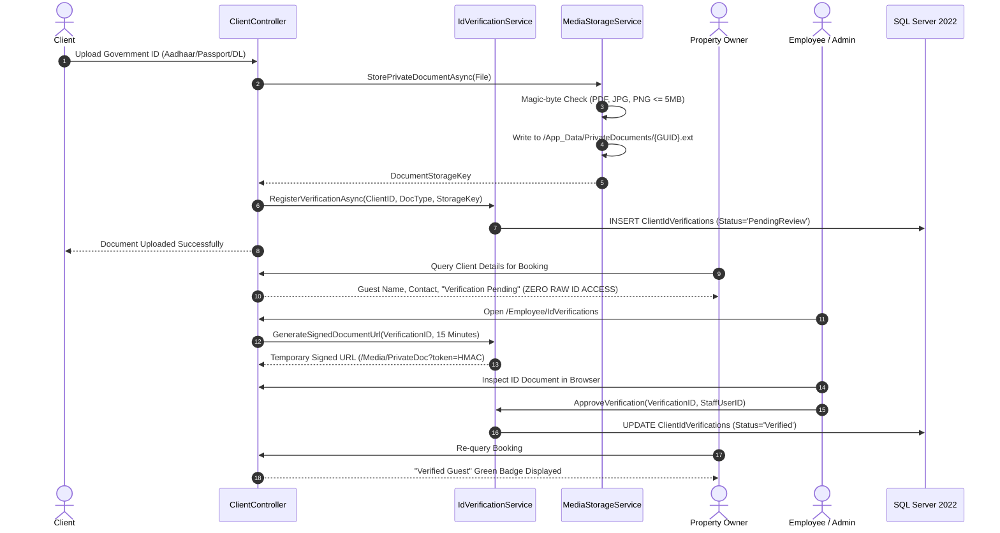
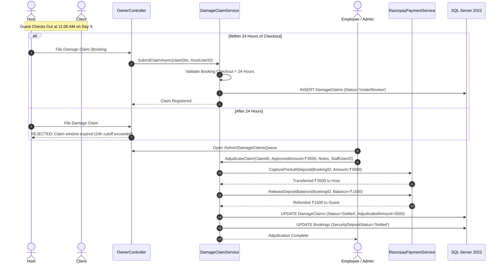

# BookMyFun — Platform System Architecture Specification

## 1. Architectural Overview & System Topology

BookMyFun is an enterprise-grade Farmhouse, Luxury Villa, and Resort rental platform built on **ASP.NET Core (.NET 10)**, **Microsoft SQL Server 2022**, and **Raw Parameterized ADO.NET** (`Microsoft.Data.SqlClient`). Designed for predictable high-throughput and zero ORM overhead, the system incorporates tenant isolation, multi-dashboard Role-Based Access Control (RBAC), bank-grade media processing, automated refund calculation, and multi-tier host monetization.

### 1.1 High-Level Architecture Diagram



---

## 2. Multi-Dashboard Role-Based Access Control (RBAC) Matrix

BookMyFun enforces strict tenant isolation and role separation across four distinct dashboards:

| Operational Capability | Client | Owner (Host) | Employee | Admin | Security & Isolation Enforcement |
|:---|:---:|:---:|:---:|:---:|:---|
| **Browse Catalog & Geo-Search** | Read | Read | Read | Read | Public access; rate limited to 100 req/min |
| **Partner Lead Submission** | Create | - | Review | Review | Public form; no user created until approved |
| **Host Activation via Token** | - | Complete Setup | Dispatch | Dispatch | 48h encrypted HMAC-SHA256 token |
| **Property CRUD Management** | - | Scoped (Self) | Full | Full | Tenant isolation: `WHERE OwnerID = @CurrentUserID` |
| **Dual Media Upload (Files/URLs)**| - | Scoped (Self) | Full | Full | Magic-byte checked files + SSRF-filtered URLs |
| **Booking Creation & Slot Hold** | Create | - | Staff Booking | Full | Commission and cancellation snapshots stored |
| **Booking Cancellation & Refund** | Self Request | - | Override Queue | Override Queue | Real-time policy breakdown modal before submit |
| **Raw Government ID Access** | Self (Owner) | **DENIED** | 15-min Expiring | 15-min Expiring | Stored in `/App_Data/PrivateDocuments/` |
| **Guest Verification Badge** | - | Flag Guest | Review & Grant | Review & Grant | Host sees only "Verified Guest" badge, zero PII |
| **Security Deposit Hold & Claim** | Hold at Pay | File Claim (24h) | Adjudicate | Adjudicate | 24h deadline post-checkout with photo evidence |
| **Subscription Tiers & Monetization**| - | View/Upgrade | Manage | Full Override | Free, Featured, Managed Concierge Pack |
| **Financial Ledgers & Analytics** | - | Scoped Payouts | Support Stats | Full Dashboard | Date presets, ClosedXML Excel, streaming CSV |
| **User & Account Management** | Self Profile | Self Profile | Support View | Full (Suspend/Reset)| Cryptographic audit logs on all state mutations |
| **Platform Config & API Keys** | - | - | - | Full | AES/HMAC encrypted settings in database |

---

## 3. Layered Architectural Decomposition

### 3.1 Presentation & Routing Layer
- **Technology:** ASP.NET Core MVC with Razor View Engine.
- **Unified Views for Operations:** Admin and Employee dashboards share operational views (`Views/Admin/RefundsQueue.cshtml`, `Views/Admin/OnboardingLeads.cshtml`, `Views/Admin/DamageClaimsQueue.cshtml`, `Views/Admin/IdVerificationsQueue.cshtml`). The active controller context (`@controllerName`) dynamically switches form submission endpoints to prevent permission elevation.
- **Asynchronous AJAX Endpoints:** Lightweight RESTful actions return standardized JSON payloads (`{ success: true, data: ... }` or `{ success: false, error: ... }`).

### 3.2 Security & Middleware Pipeline
1. **SecurityHeadersMiddleware:**
   - Injects `Content-Security-Policy`, `X-Content-Type-Options: nosniff`, `X-Frame-Options: DENY`, `Referrer-Policy: strict-origin-when-cross-origin`, and `Permissions-Policy`.
2. **RateLimitingMiddleware:**
   - Sliding-window in-memory IP rate limiter enforcing 100 requests per minute per IP, protecting search and login endpoints from volumetric abuse.
3. **CookieAuthenticationMiddleware:**
   - Enforces `HttpOnly: true`, `SameSite: Strict`, and `SecurePolicy: SameAsRequest` with a 7-day sliding expiration window.
4. **GlobalExceptionFilter:**
   - Catches unhandled exceptions, logs detailed telemetry with correlation IDs, and renders clean user error pages or JSON error bodies without leaking database structures.

### 3.3 Domain Services Layer

| Service Name | Primary Responsibilities |
|:---|:---|
| [`MediaStorageService`](file:///d:/Projects/BookMyFun/Services/MediaStorageService.cs) | Magic-byte file validation, UUID filename assignment, private vault storage, SSRF URL defense with DNS validation. |
| [`RefundEngineService`](file:///d:/Projects/BookMyFun/Services/RefundEngineService.cs) | Real-time refund estimation, policy snapshot evaluation, 2% gateway deduction, and automated/manual refund processing. |
| [`CommissionService`](file:///d:/Projects/BookMyFun/Services/BookingAndCommissionService.cs) | Three-tier commission resolution (`Property.CommissionRate ?? Owner.CustomCommissionRate ?? GlobalSettings.10%`) and ledger balance calculation. |
| [`DamageClaimService`](file:///d:/Projects/BookMyFun/Services/DamageClaimService.cs) | Enforces 24-hour post-checkout filing deadline, itemized damage costs, evidence media links, and deposit release/deduction adjudication. |
| [`PartnerLeadService`](file:///d:/Projects/BookMyFun/Services/PartnerLeadService.cs) | Ingests host partnership inquiries, facilitates staff triage, generates encrypted 48-hour activation tokens, and activates owner accounts. |
| [`IdVerificationService`](file:///d:/Projects/BookMyFun/Services/IdVerificationService.cs) | Secure document intake (Aadhaar, Passport, DL), 15-minute expiring HMAC-SHA256 URL generation, and guest verification badge issuance. |
| [`BookingPricingService`](file:///d:/Projects/BookMyFun/Services/BookingAndCommissionService.cs) | Calculates multi-duration rates (Full Day, Morning/Evening slots, Multi-day), security deposit requirements, and tax totals. |
| [`RazorpayPaymentService`](file:///d:/Projects/BookMyFun/Services/PaymentGatewayService.cs) | Tokenized checkout creation, HMAC-SHA256 webhook signature verification, payment status confirmation, and refund API dispatch. |
| [`CommunicationService`](file:///d:/Projects/BookMyFun/Services/CommunicationService.cs) | Dispatches transactional booking confirmations, OTP verification codes, and host activation emails. |
| [`SiteSettingsService`](file:///d:/Projects/BookMyFun/Services/SiteSettingsService.cs) | Manages global platform settings, commission percentages, support contact details, and encrypted third-party credentials. |

### 3.4 Data Access Layer (Raw ADO.NET)
- **Elimination of ORM Latency:** Queries execute directly through `Microsoft.Data.SqlClient` with explicit parameterized queries, eliminating EF Core change tracker overhead.
- **Helper Architecture (`DBHelper`):** Centralizes connection management, parameterized command creation, null value normalization (`DBNull.Value`), and scalar/reader/non-query execution.
- **Idempotent Evolution (`DatabaseInitializer`):** Automatically initializes schemas, creates missing tables, and applies schema additions on application boot without external migration scripts.

---

## 4. Sequence Diagrams of Core Workflows

### 4.1 Booking, Pricing Snapshot & Payment Workflow



### 4.2 Cancellation & Automated Refund Workflow



### 4.3 Partner Lead Onboarding & Host Activation



### 4.4 Client Government ID Verification & Privacy Shield



### 4.5 Security Deposit Hold & 24-Hour Damage Claim Adjudication



---

## 5. Security & Isolation Architecture

### 5.1 Object-Level Access Control (IDOR Defense)
- **Multi-Tenant Scoping:** Every query executed within `OwnerController` and `PropertyRepository` includes the owner identifier:
  ```sql
  SELECT * FROM Properties WHERE PropertyID = @PropertyID AND OwnerID = @CurrentUserID;
  ```
- **Staff Sovereign Access:** `Admin` and `Employee` roles bypass owner tenant scoping for administrative oversight, with all actions recorded in `AuditLogs`.

### 5.2 Server-Side Request Forgery (SSRF) Defense
- When external media URLs (YouTube, Vimeo, Cloudinary, AWS S3) are submitted:
  1. The URI scheme is strictly verified to be `https://`.
  2. The hostname is resolved to an IPv4/IPv6 address via DNS.
  3. The resolved address is checked against private, loopback, and cloud metadata ranges (`127.0.0.1`, `10.0.0.0/8`, `172.16.0.0/12`, `192.168.0.0/16`, `169.254.169.254`).
  4. If any internal or link-local address is matched, the request is immediately aborted with a `SecurityViolationException`.

### 5.3 Cryptographic Audit Trail
- Every administrative mutation, cancellation override, damage claim adjudication, and owner status change writes to `AuditLogs` containing:
  - `PerformedByUserID`
  - `Action`
  - `EntityType`
  - `EntityID`
  - `Details` (JSON payload)
  - `Timestamp`

---

## 6. Scalability & Deployment Architecture

- **Stateless Application Tier:** ASP.NET Core application nodes are stateless; sessions and authentication rely on signed HTTP-only cookies and SQL persistence, allowing horizontal scaling behind AWS ALB / Azure Application Gateway / Nginx.
- **Static Assets Offloading:** Media uploads are structured to easily transition from local disk (`wwwroot/uploads`) to S3/Cloudflare R2 buckets by changing `IMediaStorageService` configuration without touching business controllers.
- **Database Partitioning Readiness:** The 26 normalized SQL tables maintain foreign key boundaries enabling future table partitioning on `Bookings`, `FinancialLedger`, and `AuditLogs` by fiscal year.
