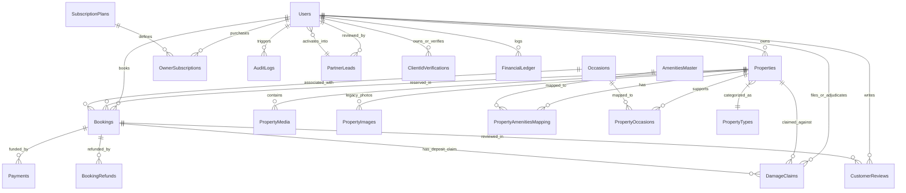

# BookMyFun — Database Architecture & Data Dictionary

## 1. Database Architecture & Design Principles

The BookMyFun persistence layer is built on **Microsoft SQL Server 2022** and accessed strictly via **Raw Parameterized ADO.NET** using `Microsoft.Data.SqlClient`. The database is modeled according to the Third Normal Form (3NF) to ensure data normalization, prevent anomalies, and maintain atomic integrity across financial transactions.

### Key Architectural Highlights:
1. **Zero ORM Overhead:** Eliminates Entity Framework Core overhead, memory caches, and implicit client-side evaluation. All queries execute through [`DBHelper.cs`](file:///d:/Projects/BookMyFun/Data/DBHelper.cs) using explicit parameterized `SqlCommand` objects.
2. **Idempotent Migration on Startup:** Database schemas, structural additions, indexes, and seeded records are managed automatically through [`DatabaseInitializer.cs`](file:///d:/Projects/BookMyFun/Data/DatabaseInitializer.cs) and [`DatabaseSeeder.cs`](file:///d:/Projects/BookMyFun/Data/DatabaseSeeder.cs) on application bootstrap.
3. **Immutable Financial & Policy Snapshots:** Crucial pricing, commission rates, and cancellation policies are snapshotted onto the `Bookings` record at checkout time to ensure that subsequent updates to properties or platform defaults never mutate historic agreements.
4. **Relational Constraints & Cascades:** Referential integrity is strictly maintained via foreign keys, cascading deletes on dependent child entities (e.g. `PropertyImages`, `PropertyMedia`, `PropertyAmenitiesMapping`), and strict `CHECK` constraints on state enumerations.

---

## 2. Entity-Relationship (ER) Diagram



---

## 3. Complete Data Dictionary (26 Tables)

### 3.1 Authentication, Users & Identity

#### 1. `Users`
Stores account credentials, role designations, host commission overrides, and subscription tiers.
| Column | Data Type | Nullable | Constraints & Defaults | Description |
|:---|:---|:---:|:---|:---|
| `UserID` | `INT` | No | PK, IDENTITY(1,1) | Unique user surrogate identifier |
| `FullName` | `NVARCHAR(100)` | No | - | User display and legal name |
| `Email` | `NVARCHAR(100)` | No | UNIQUE | Normalized email address for login |
| `PasswordHash` | `NVARCHAR(255)` | No | - | BCrypt/PBKDF2 salted hash |
| `Phone` | `NVARCHAR(20)` | Yes | - | Primary contact phone number |
| `Role` | `NVARCHAR(20)` | No | CHECK ('Admin', 'Employee', 'Owner', 'Client') | Security authorization role |
| `IsActive` | `BIT` | No | DEFAULT 1 | Account status flag |
| `CustomCommissionRate` | `DECIMAL(5,2)` | Yes | - | Host-specific commission rate override |
| `SubscriptionTier` | `NVARCHAR(30)` | No | DEFAULT 'Free' | 'Free', 'Featured', 'Managed' |
| `CreatedAt` | `DATETIME2` | No | DEFAULT GETDATE() | Record creation timestamp |

#### 2. `OtpVerifications`
Manages one-time passwords for mobile/email verification, password resets, and booking holds.
| Column | Data Type | Nullable | Constraints & Defaults | Description |
|:---|:---|:---:|:---|:---|
| `OtpID` | `INT` | No | PK, IDENTITY(1,1) | Surrogate OTP identifier |
| `Contact` | `NVARCHAR(100)` | No | - | Target email address or phone number |
| `OtpCode` | `NVARCHAR(10)` | No | - | 6-digit numeric OTP code |
| `Purpose` | `NVARCHAR(50)` | No | - | 'Registration', 'Login', 'Booking' |
| `ExpiresAt` | `DATETIME2` | No | - | Code expiration timestamp (10 mins) |
| `IsUsed` | `BIT` | No | DEFAULT 0 | Consumption status |
| `CreatedAt` | `DATETIME2` | No | DEFAULT GETDATE() | Issuance timestamp |

#### 3. `ClientIdVerifications`
Private vault tracking guest government identity documents and staff review statuses.
| Column | Data Type | Nullable | Constraints & Defaults | Description |
|:---|:---|:---:|:---|:---|
| `VerificationID` | `INT` | No | PK, IDENTITY(1,1) | Surrogate identity record key |
| `ClientID` | `INT` | No | FK -> `Users(UserID)` | Reference to guest user |
| `DocumentType` | `NVARCHAR(50)` | No | - | 'Aadhaar', 'Passport', 'DrivingLicense' |
| `DocumentStorageKey` | `NVARCHAR(500)` | No | - | Relative path inside `/App_Data/PrivateDocuments/` |
| `MaskedIdentifier` | `NVARCHAR(20)` | Yes | - | Masked string (e.g., `XXXX-XXXX-1234`) |
| `VerificationStatus`| `NVARCHAR(30)` | No | CHECK ('PendingReview', 'Verified', 'Rejected') | Review status |
| `RejectionReason` | `NVARCHAR(255)` | Yes | - | Reason provided if rejected by staff |
| `VerifiedByUserID` | `INT` | Yes | FK -> `Users(UserID)` | Staff member who adjudicated KYC |
| `VerifiedAt` | `DATETIME2` | Yes | - | Approval/rejection timestamp |
| `CreatedAt` | `DATETIME2` | No | DEFAULT GETDATE() | Upload timestamp |

---

### 3.2 Property Catalog & Taxonomies

#### 4. `PropertyTypes`
Taxonomy of farm and villa property structures.
| Column | Data Type | Nullable | Constraints & Defaults | Description |
|:---|:---|:---:|:---|:---|
| `PropertyTypeID` | `INT` | No | PK, IDENTITY(1,1) | Category surrogate key |
| `TypeName` | `NVARCHAR(50)` | No | - | 'Farmhouse', 'Luxury Villa', 'Eco Resort' |
| `Description` | `NVARCHAR(MAX)` | Yes | - | Category description |

#### 5. `Occasions`
Supported event types for farm rentals (Weddings, Family Gatherings, Parties).
| Column | Data Type | Nullable | Constraints & Defaults | Description |
|:---|:---|:---:|:---|:---|
| `OccasionID` | `INT` | No | PK, IDENTITY(1,1) | Occasion surrogate key |
| `OccasionName` | `NVARCHAR(50)` | No | - | Event occasion title |
| `Description` | `NVARCHAR(MAX)` | Yes | - | Event type details |

#### 6. `AmenitiesMaster`
Master list of standardized platform amenities with Bootstrap icon classes and categories.
| Column | Data Type | Nullable | Constraints & Defaults | Description |
|:---|:---|:---:|:---|:---|
| `AmenityID` | `INT` | No | PK, IDENTITY(1,1) | Primary key |
| `AmenityName` | `NVARCHAR(50)` | No | UNIQUE | Display name (e.g., 'Swimming Pool') |
| `IconClass` | `NVARCHAR(50)` | No | - | CSS icon class (e.g., 'bi-water') |
| `Category` | `NVARCHAR(50)` | No | DEFAULT 'General' | Taxonomy grouping |

#### 7. `Properties`
The core property listing entity with geolocation, pricing, security deposit, and cancellation rules.
| Column | Data Type | Nullable | Constraints & Defaults | Description |
|:---|:---|:---:|:---|:---|
| `PropertyID` | `INT` | No | PK, IDENTITY(1,1) | Property surrogate identifier |
| `OwnerID` | `INT` | No | FK -> `Users(UserID)` | Owning farm host user key |
| `PropertyTypeID` | `INT` | No | FK -> `PropertyTypes(PropertyTypeID)` | Category key |
| `Title` | `NVARCHAR(150)` | No | - | Public listing title |
| `Description` | `NVARCHAR(MAX)` | Yes | - | Full markdown description |
| `Location` | `NVARCHAR(255)` | No | - | City, Region or Area name |
| `FormattedAddress`| `NVARCHAR(500)` | Yes | - | Full Google Places formatted address |
| `Latitude` | `DECIMAL(9,6)` | Yes | - | GPS latitude coordinate |
| `Longitude` | `DECIMAL(9,6)` | Yes | - | GPS longitude coordinate |
| `PricePerNight` | `DECIMAL(18,2)` | No | - | Base overnight rental rate |
| `MaxGuests` | `INT` | No | - | Maximum permitted occupant capacity |
| `SecurityDepositAmount` | `DECIMAL(18,2)` | No | DEFAULT 0.00 | Damage security hold amount |
| `CommissionRate` | `DECIMAL(5,2)` | Yes | - | Property-level platform commission override |
| `FreeCancellationWindowHours` | `INT` | No | DEFAULT 48 | Hours before check-in for full refund |
| `CancellationCutoffHours` | `INT` | No | DEFAULT 24 | Hard deadline after which non-refundable |
| `CancellationFeeType` | `NVARCHAR(20)` | No | DEFAULT 'percentage' | 'percentage' or 'fixed' |
| `CancellationFeeValue` | `DECIMAL(18,2)`| No | DEFAULT 10.00 | Penalty fee value |
| `IsFeatured` | `BIT` | No | DEFAULT 0 | Featured carousel display flag |
| `ListingStatus` | `NVARCHAR(20)` | No | CHECK ('Draft', 'PendingPayment', 'Active', 'Expired') | Lifecycle status |
| `IsApproved` | `BIT` | No | DEFAULT 0 | Staff moderation approval flag |
| `CreatedAt` | `DATETIME2` | No | DEFAULT GETDATE() | Record creation timestamp |

#### 8. `PropertyAmenitiesMapping`
Many-to-many junction linking properties with active amenities.
| Column | Data Type | Nullable | Constraints & Defaults | Description |
|:---|:---|:---:|:---|:---|
| `PropertyID` | `INT` | No | PK, FK -> `Properties(PropertyID)` ON DELETE CASCADE | Target property key |
| `AmenityID` | `INT` | No | PK, FK -> `AmenitiesMaster(AmenityID)` ON DELETE CASCADE | Associated amenity key |

#### 9. `PropertyOccasions`
Many-to-many junction linking properties with permitted occasions.
| Column | Data Type | Nullable | Constraints & Defaults | Description |
|:---|:---|:---:|:---|:---|
| `PropertyID` | `INT` | No | PK, FK -> `Properties(PropertyID)` ON DELETE CASCADE | Target property key |
| `OccasionID` | `INT` | No | PK, FK -> `Occasions(OccasionID)` ON DELETE CASCADE | Associated occasion key |

#### 10. `PropertyMedia`
Dual-mode media gallery supporting uploaded files and verified external URLs.
| Column | Data Type | Nullable | Constraints & Defaults | Description |
|:---|:---|:---:|:---|:---|
| `MediaID` | `INT` | No | PK, IDENTITY(1,1) | Media item identifier |
| `PropertyID` | `INT` | No | FK -> `Properties(PropertyID)` ON DELETE CASCADE | Owning property key |
| `MediaType` | `NVARCHAR(10)` | No | CHECK ('photo', 'video') | Media content format |
| `SourceType` | `NVARCHAR(10)` | No | CHECK ('file', 'url') | Ingestion source origin |
| `StorageUrl` | `NVARCHAR(MAX)`| No | - | Disk relative path or external HTTPS link |
| `PublicId` | `NVARCHAR(255)`| Yes | - | Cloudinary/S3 unique resource handle |
| `IsPrimary` | `BIT` | No | DEFAULT 0 | Main listing thumbnail flag |
| `SortOrder` | `INT` | No | DEFAULT 0 | Display sequence order |
| `CreatedAt` | `DATETIME2` | No | DEFAULT GETDATE() | Record creation timestamp |

#### 11. `PropertyImages` (Legacy)
Preserved for backward compatibility with older listing setups.
| Column | Data Type | Nullable | Constraints & Defaults | Description |
|:---|:---|:---:|:---|:---|
| `ImageID` | `INT` | No | PK, IDENTITY(1,1) | Image primary key |
| `PropertyID` | `INT` | No | FK -> `Properties(PropertyID)` ON DELETE CASCADE | Target property key |
| `ImageURL` | `NVARCHAR(MAX)`| No | - | Image file path |
| `IsPrimary` | `BIT` | No | DEFAULT 0 | Primary thumbnail indicator |

---

### 3.3 Bookings, Payments & Financials

#### 12. `Bookings`
Primary reservation entity containing immutable commission snapshots, cancellation policy snapshots, and security deposit tracking.
| Column | Data Type | Nullable | Constraints & Defaults | Description |
|:---|:---|:---:|:---|:---|
| `BookingID` | `INT` | No | PK, IDENTITY(1,1) | Booking surrogate identifier |
| `PropertyID` | `INT` | No | FK -> `Properties(PropertyID)` | Reserved property |
| `ClientID` | `INT` | No | FK -> `Users(UserID)` | Booking guest |
| `OccasionID` | `INT` | Yes | FK -> `Occasions(OccasionID)` | Selected occasion event |
| `CheckInDate` | `DATE` | No | - | Check-in calendar date |
| `CheckOutDate` | `DATE` | No | - | Check-out calendar date |
| `BookingType` | `NVARCHAR(30)` | No | DEFAULT 'FullDay' | 'FullDay', 'Slot' |
| `SlotType` | `NVARCHAR(30)` | Yes | - | 'Morning', 'Evening', 'Custom' |
| `SlotStartTime`| `TIME` | Yes | - | Slot start time |
| `SlotEndTime` | `TIME` | Yes | - | Slot end time |
| `TotalAmount` | `DECIMAL(18,2)` | No | - | Gross reservation amount paid |
| `Status` | `NVARCHAR(20)` | No | CHECK ('Pending', 'Confirmed', 'Cancelled') | Reservation lifecycle status |
| `CommissionRateSnapshot` | `DECIMAL(5,2)` | No | DEFAULT 10.00 | Snapshot of platform commission % |
| `PlatformCommissionAmount`| `DECIMAL(18,2)` | No | DEFAULT 0.00 | Calculated platform fee |
| `OwnerPayoutAmount` | `DECIMAL(18,2)` | No | DEFAULT 0.00 | Net host payout |
| `FreeCancellationWindowHoursSnapshot` | `INT` | No | DEFAULT 48 | Policy snapshot for free cancellation |
| `CancellationCutoffHoursSnapshot` | `INT` | No | DEFAULT 24 | Policy snapshot for non-refundable cutoff |
| `CancellationFeeTypeSnapshot` | `NVARCHAR(20)` | No | DEFAULT 'percentage' | Fee type snapshot |
| `CancellationFeeValueSnapshot`| `DECIMAL(18,2)`| No | DEFAULT 10.00 | Fee amount snapshot |
| `SecurityDepositAmount` | `DECIMAL(18,2)` | No | DEFAULT 0.00 | Held security deposit amount |
| `SecurityDepositStatus` | `NVARCHAR(30)` | No | DEFAULT 'Held' | 'Held', 'Refunded', 'Claimed', 'Settled' |
| `IdempotencyKey` | `NVARCHAR(100)`| Yes | - | Duplicate request prevention token |
| `CreatedAt` | `DATETIME2` | No | DEFAULT GETDATE() | Reservation timestamp |

#### 13. `Payments`
Payment gateway transaction audit log.
| Column | Data Type | Nullable | Constraints & Defaults | Description |
|:---|:---|:---:|:---|:---|
| `PaymentID` | `INT` | No | PK, IDENTITY(1,1) | Surrogate payment key |
| `BookingID` | `INT` | No | FK -> `Bookings(BookingID)` ON DELETE CASCADE | Associated booking |
| `GatewayTransactionID` | `NVARCHAR(100)` | Yes | - | Razorpay/Cashfree payment identifier |
| `Amount` | `DECIMAL(18,2)` | No | - | Amount captured |
| `PaymentStatus` | `NVARCHAR(20)` | No | CHECK ('Success', 'Failed') | Transaction outcome |
| `PaymentDate` | `DATETIME2` | No | DEFAULT GETDATE() | Transaction timestamp |

#### 14. `BookingRefunds`
Tracks full/partial cancellation refunds, fee deductions, and payment gateway refund IDs.
| Column | Data Type | Nullable | Constraints & Defaults | Description |
|:---|:---|:---:|:---|:---|
| `RefundID` | `INT` | No | PK, IDENTITY(1,1) | Refund primary key |
| `BookingID` | `INT` | No | FK -> `Bookings(BookingID)` | Associated cancelled booking |
| `GrossBookingAmount` | `DECIMAL(18,2)` | No | - | Total originally captured |
| `CancellationFeeDeducted` | `DECIMAL(18,2)` | No | - | Penalty fee withheld |
| `GatewayFeeDeducted` | `DECIMAL(18,2)` | No | - | 2% gateway processing fee withheld |
| `NetRefundAmount` | `DECIMAL(18,2)` | No | - | Actual net refund credited to customer |
| `RefundReason` | `NVARCHAR(500)` | Yes | - | Customer or operational reason |
| `Status` | `NVARCHAR(30)` | No | CHECK ('Initiated', 'Processing', 'Completed', 'Failed', 'Overridden') | Refund status |
| `GatewayRefundID` | `NVARCHAR(100)` | Yes | - | Razorpay refund identifier |
| `ProcessedByUserID` | `INT` | Yes | FK -> `Users(UserID)` | User who executed refund |
| `ProcessedAt` | `DATETIME2` | Yes | - | Completion timestamp |
| `CreatedAt` | `DATETIME2` | No | DEFAULT GETDATE() | Record creation timestamp |

#### 15. `DamageClaims`
Host security deposit claims filed within 24 hours of guest checkout.
| Column | Data Type | Nullable | Constraints & Defaults | Description |
|:---|:---|:---:|:---|:---|
| `ClaimID` | `INT` | No | PK, IDENTITY(1,1) | Surrogate damage claim key |
| `BookingID` | `INT` | No | FK -> `Bookings(BookingID)` | Relevant booking reservation |
| `PropertyID` | `INT` | No | FK -> `Properties(PropertyID)` | Location of damage |
| `OwnerID` | `INT` | No | FK -> `Users(UserID)` | Host filing the claim |
| `ClaimAmount` | `DECIMAL(18,2)` | No | - | Total claimed damages |
| `ItemizedDescription`| `NVARCHAR(MAX)` | No | - | Itemized damage breakdown |
| `EvidenceMediaUrls` | `NVARCHAR(MAX)` | No | - | JSON array of photo/video evidence links |
| `Status` | `NVARCHAR(30)` | No | CHECK ('UnderReview', 'Approved', 'Rejected', 'Settled') | Adjudication status |
| `AdjudicatedAmount` | `DECIMAL(18,2)` | Yes | - | Amount granted by staff |
| `AdjudicatedByUserID`| `INT` | Yes | FK -> `Users(UserID)` | Staff member who adjudicated |
| `AdjudicationNotes` | `NVARCHAR(MAX)` | Yes | - | Findings and settlement rationale |
| `AdjudicatedAt` | `DATETIME2` | Yes | - | Resolution timestamp |
| `CreatedAt` | `DATETIME2` | No | DEFAULT GETDATE() | Filing timestamp |

#### 16. `FinancialLedger`
Internal double-entry tracking for business operational revenue and expenses.
| Column | Data Type | Nullable | Constraints & Defaults | Description |
|:---|:---|:---:|:---|:---|
| `LedgerID` | `INT` | No | PK, IDENTITY(1,1) | Ledger surrogate identifier |
| `TransactionType` | `NVARCHAR(20)` | No | CHECK ('Income', 'Expense') | Financial classification |
| `Category` | `NVARCHAR(50)` | No | - | 'BookingCommission', 'Subscription', 'Marketing', etc. |
| `Amount` | `DECIMAL(18,2)` | No | - | Transaction amount |
| `Title` | `NVARCHAR(150)` | No | - | Ledger line item title |
| `Details` | `NVARCHAR(MAX)` | Yes | - | Contextual notes |
| `TransactionDate` | `DATE` | No | - | Effective accounting date |
| `LoggedByUserID` | `INT` | Yes | FK -> `Users(UserID)` | Staff member who posted entry |
| `CreatedAt` | `DATETIME2` | No | DEFAULT GETDATE() | System entry timestamp |

---

### 3.4 Host Monetization, Subscriptions & Leads

#### 17. `SubscriptionPlans`
Host membership tiers offering listing capacity and featured placement.
| Column | Data Type | Nullable | Constraints & Defaults | Description |
|:---|:---|:---:|:---|:---|
| `PlanID` | `INT` | No | PK, IDENTITY(1,1) | Plan surrogate key |
| `PlanName` | `NVARCHAR(50)` | No | - | 'Starter Free', 'Spotlight Featured', 'Concierge Pack' |
| `Price` | `DECIMAL(18,2)` | No | - | Plan subscription cost |
| `DurationInDays`| `INT` | No | - | Plan duration (e.g., 30, 90, 365) |
| `MaxListings` | `INT` | No | - | Allowed concurrent listings |
| `IsActive` | `BIT` | No | DEFAULT 1 | Availability toggle |

#### 18. `OwnerSubscriptions`
Records of active and expired host subscriptions.
| Column | Data Type | Nullable | Constraints & Defaults | Description |
|:---|:---|:---:|:---|:---|
| `SubscriptionID` | `INT` | No | PK, IDENTITY(1,1) | Subscription record key |
| `OwnerID` | `INT` | No | FK -> `Users(UserID)` | Target host user |
| `PlanID` | `INT` | No | FK -> `SubscriptionPlans(PlanID)` | Subscribed plan |
| `StartDate` | `DATETIME2` | No | - | Plan validity start |
| `EndDate` | `DATETIME2` | No | - | Plan validity expiration |
| `PaymentStatus` | `NVARCHAR(20)` | No | CHECK ('Paid', 'Pending', 'Expired') | Subscription status |
| `GatewayTransactionID` | `NVARCHAR(100)` | Yes | - | Gateway reference ID |

#### 19. `PropertyListingPayments`
One-time listing setup or concierge pack payments.
| Column | Data Type | Nullable | Constraints & Defaults | Description |
|:---|:---|:---:|:---|:---|
| `ListingPaymentID` | `INT` | No | PK, IDENTITY(1,1) | Payment primary key |
| `PropertyID` | `INT` | No | FK -> `Properties(PropertyID)` ON DELETE CASCADE | Target listing |
| `OwnerID` | `INT` | No | FK -> `Users(UserID)` | Host making payment |
| `Amount` | `DECIMAL(18,2)` | No | - | Paid amount |
| `PaymentStatus` | `NVARCHAR(20)` | No | CHECK ('Success', 'Failed', 'Pending') | Status outcome |
| `GatewayTransactionID`| `NVARCHAR(100)` | Yes | - | Transaction key |
| `PaymentDate` | `DATETIME2` | No | DEFAULT GETDATE() | Timestamp |

#### 20. `PartnerLeads`
Host lead-intake pipeline replacing open public host self-registration.
| Column | Data Type | Nullable | Constraints & Defaults | Description |
|:---|:---|:---:|:---|:---|
| `LeadID` | `INT` | No | PK, IDENTITY(1,1) | Lead surrogate key |
| `FullName` | `NVARCHAR(100)` | No | - | Applicant name |
| `Phone` | `NVARCHAR(20)` | No | - | Phone number |
| `Email` | `NVARCHAR(100)` | No | - | Contact email |
| `PropertyName` | `NVARCHAR(150)` | No | - | Farm or villa property name |
| `Location` | `NVARCHAR(255)` | No | - | City, State or District |
| `AcreageOrType` | `NVARCHAR(100)` | No | - | Land area (e.g., '5 Acres Farm') |
| `Message` | `NVARCHAR(MAX)` | Yes | - | Host message |
| `Status` | `NVARCHAR(30)` | No | CHECK ('New', 'Contacted', 'Approved', 'Rejected') | Onboarding status |
| `ActivationToken` | `NVARCHAR(255)`| Yes | - | Encrypted 48-hour activation token |
| `TokenExpiresAt`| `DATETIME2` | Yes | - | Token expiry date |
| `ReviewedByUserID`| `INT` | Yes | FK -> `Users(UserID)` | Reviewing staff member |
| `CreatedAt` | `DATETIME2` | No | DEFAULT GETDATE() | Submission timestamp |

#### 21. `OwnerRequests`
Manages trial period listing requests and administrative notes.
| Column | Data Type | Nullable | Constraints & Defaults | Description |
|:---|:---|:---:|:---|:---|
| `RequestID` | `INT` | No | PK, IDENTITY(1,1) | Request primary key |
| `UserID` | `INT` | No | FK -> `Users(UserID)` ON DELETE CASCADE | Host requesting trial |
| `RequestedAt` | `DATETIME2` | No | DEFAULT GETDATE() | Request date |
| `TrialDeadline`| `DATETIME2` | No | - | 1-2 day evaluation window |
| `Status` | `NVARCHAR(30)` | No | CHECK ('PendingEvaluation', 'Approved', 'Rejected') | Request status |
| `AdminNotes` | `NVARCHAR(MAX)` | Yes | - | Evaluation notes |
| `ReviewedByUserID`| `INT` | Yes | FK -> `Users(UserID)` | Reviewing administrator |
| `ReviewedAt` | `DATETIME2` | Yes | - | Approval date |

---

### 3.5 Communications, Reviews & Auditing

#### 22. `CustomerReviews`
Guest feedback, ratings (1 to 5 stars), and testimonials.
| Column | Data Type | Nullable | Constraints & Defaults | Description |
|:---|:---|:---:|:---|:---|
| `ReviewID` | `INT` | No | PK, IDENTITY(1,1) | Primary key |
| `BookingID` | `INT` | No | FK -> `Bookings(BookingID)` | Verified stay |
| `ClientID` | `INT` | No | FK -> `Users(UserID)` | Review author |
| `PropertyID` | `INT` | No | FK -> `Properties(PropertyID)` | Reviewed farm |
| `Rating` | `INT` | No | CHECK (Rating BETWEEN 1 AND 5) | Star rating |
| `Comment` | `NVARCHAR(MAX)` | Yes | - | Review text |
| `CreatedAt` | `DATETIME2` | No | DEFAULT GETDATE() | Submission date |

#### 23. `ContactUs`
Public customer support messages and inquiry tracking.
| Column | Data Type | Nullable | Constraints & Defaults | Description |
|:---|:---|:---:|:---|:---|
| `ContactID` | `INT` | No | PK, IDENTITY(1,1) | Message primary key |
| `Name` | `NVARCHAR(100)` | No | - | Sender name |
| `Email` | `NVARCHAR(100)` | No | - | Sender email |
| `Phone` | `NVARCHAR(20)` | Yes | - | Contact phone |
| `Subject` | `NVARCHAR(255)` | Yes | - | Message topic |
| `Message` | `NVARCHAR(MAX)` | No | - | Message body |
| `Status` | `NVARCHAR(20)` | No | CHECK ('New', 'Responded') | Triage status |
| `CreatedAt` | `DATETIME2` | No | DEFAULT GETDATE() | Inquiry timestamp |

#### 24. `AuditLogs`
Immutable security and administrative audit trail.
| Column | Data Type | Nullable | Constraints & Defaults | Description |
|:---|:---|:---:|:---|:---|
| `AuditID` | `INT` | No | PK, IDENTITY(1,1) | Audit record key |
| `PerformedByUserID` | `INT` | No | FK -> `Users(UserID)` | Acting user |
| `Action` | `NVARCHAR(100)` | No | - | Action identifier (e.g., 'OverrideRefund') |
| `EntityType` | `NVARCHAR(50)` | No | - | Target entity (e.g., 'Booking') |
| `EntityID` | `INT` | Yes | - | Target record identifier |
| `Details` | `NVARCHAR(MAX)` | Yes | - | JSON serialized context payload |
| `Timestamp` | `DATETIME2` | No | DEFAULT GETDATE() | Event execution timestamp |

#### 25. `SiteSettings`
Dynamic key-value platform configurations.
| Column | Data Type | Nullable | Constraints & Defaults | Description |
|:---|:---|:---:|:---|:---|
| `SettingID` | `INT` | No | PK, IDENTITY(1,1) | Key identifier |
| `SettingKey` | `NVARCHAR(100)` | No | UNIQUE | Configuration key name |
| `SettingValue`| `NVARCHAR(MAX)`| Yes | - | Stored configuration value |
| `IsEncrypted` | `BIT` | No | DEFAULT 0 | Encryption indicator |
| `UpdatedAt` | `DATETIME2` | No | DEFAULT GETDATE() | Modification timestamp |

#### 26. `ApiConfigurations`
Third-party integration credentials (Razorpay, SMTP, WhatsApp, Cashfree).
| Column | Data Type | Nullable | Constraints & Defaults | Description |
|:---|:---|:---:|:---|:---|
| `ConfigID` | `INT` | No | PK, IDENTITY(1,1) | Configuration key |
| `ServiceProvider`| `NVARCHAR(50)`| No | CHECK ('SMTP', 'WhatsApp', 'Razorpay', 'Cashfree') | Provider identity |
| `ApiKey` | `NVARCHAR(255)`| No | - | Public integration key |
| `ApiSecret` | `NVARCHAR(255)`| No | - | Secret or password |
| `ExtraParams` | `NVARCHAR(MAX)`| Yes | - | JSON metadata (ports, merchant IDs) |
| `IsActive` | `BIT` | No | DEFAULT 1 | Enabled status flag |

---

## 4. Database Indexes & Performance Optimizations

To ensure millisecond response times under heavy concurrent booking and search loads, the following index strategy is maintained:

```sql
-- 1. Optimizing Public Property Search by City, Status & Approval
CREATE NONCLUSTERED INDEX IX_Properties_Search 
ON Properties (ListingStatus, IsApproved, Location) 
INCLUDE (PricePerNight, MaxGuests, Title, Latitude, Longitude);

-- 2. Optimizing Owner Property Tenant Scoping
CREATE NONCLUSTERED INDEX IX_Properties_Owner 
ON Properties (OwnerID, ListingStatus);

-- 3. Optimizing Booking Overlap Checks & Date Availability
CREATE NONCLUSTERED INDEX IX_Bookings_Availability 
ON Bookings (PropertyID, Status, CheckInDate, CheckOutDate);

-- 4. Optimizing Client Booking Dashboard Queries
CREATE NONCLUSTERED INDEX IX_Bookings_Client 
ON Bookings (ClientID, Status) 
INCLUDE (CheckInDate, CheckOutDate, TotalAmount);

-- 5. Optimizing Fast Media Gallery Lookup
CREATE NONCLUSTERED INDEX IX_PropertyMedia_Property 
ON PropertyMedia (PropertyID, SortOrder, IsPrimary);

-- 6. Optimizing Dynamic Admin Financial Analytics Queries
CREATE NONCLUSTERED INDEX IX_Bookings_Analytics 
ON Bookings (Status, CreatedAt) 
INCLUDE (TotalAmount, PlatformCommissionAmount, OwnerPayoutAmount);

CREATE NONCLUSTERED INDEX IX_FinancialLedger_Date 
ON FinancialLedger (TransactionDate, TransactionType, Category);
```
