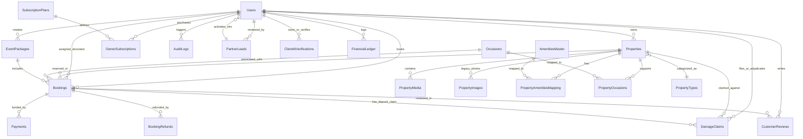

# BookMyFun — Database Architecture & Data Dictionary

## 1. Database Architecture & Design Principles

The BookMyFun persistence layer is built on **Microsoft SQL Server 2022** and accessed strictly via **Raw Parameterized ADO.NET** using `Microsoft.Data.SqlClient`. The database is modeled according to the Third Normal Form (3NF) to ensure data normalization, prevent anomalies, and maintain atomic integrity across financial transactions.

### Key Architectural Highlights:
1. **Zero ORM Overhead:** Eliminates Entity Framework Core overhead, memory caches, and implicit client-side evaluation. All queries execute through [`DBHelper.cs`](file:///d:/Projects/BookMyFun/Data/DBHelper.cs) using explicit parameterized `SqlCommand` objects.
2. **Idempotent Migration on Startup:** Database schemas, structural additions, indexes, and seeded records are managed automatically through [`DatabaseInitializer.cs`](file:///d:/Projects/BookMyFun/Data/DatabaseInitializer.cs) and [`DatabaseSeeder.cs`](file:///d:/Projects/BookMyFun/Data/DatabaseSeeder.cs) on application bootstrap across all 27 tables.
3. **Immutable Financial & Policy Snapshots:** Crucial pricing, commission rates, event package prices, and cancellation policies are snapshotted onto the `Bookings` record at checkout time to ensure that subsequent updates to properties or platform defaults never mutate historic agreements.
4. **Relational Constraints & Cascades:** Referential integrity is strictly maintained via foreign keys, cascading deletes on dependent child entities (e.g. `PropertyImages`, `PropertyMedia`, `PropertyAmenitiesMapping`), and strict `CHECK` constraints on state enumerations.

---

## 2. Entity-Relationship (ER) Diagram



---

## 3. Complete Data Dictionary (27 Tables)

### 3.1 Authentication, Users & Identity

#### 1. `Users`
Stores account credentials, role designations (5 roles), host commission overrides, and subscription tiers.
| Column | Data Type | Nullable | Constraints & Defaults | Description |
|:---|:---|:---:|:---|:---|
| `UserID` | `INT` | No | PK, IDENTITY(1,1) | Unique user surrogate identifier |
| `FullName` | `NVARCHAR(100)` | No | - | User display and legal name |
| `Email` | `NVARCHAR(100)` | No | UNIQUE | Normalized email address for login |
| `PasswordHash` | `NVARCHAR(255)` | No | - | BCrypt/PBKDF2 salted hash |
| `Phone` | `NVARCHAR(20)` | Yes | - | Primary contact phone number |
| `Role` | `NVARCHAR(20)` | No | CHECK ('Admin', 'Employee', 'Owner', 'Client', 'EventManager')) | Security authorization role |
| `IsActive` | `BIT` | No | DEFAULT 1 | Account status flag |
| `CustomCommissionRate` | `DECIMAL(5,2)` | Yes | - | Host-specific commission rate override |
| `SubscriptionTier` | `NVARCHAR(30)` | No | DEFAULT 'Free' | 'Free', 'Featured', 'Managed' |
| `CreatedAt` | `DATETIME2` | No | DEFAULT GETDATE() | Record creation timestamp |

#### 2. `OtpVerifications`
Manages one-time passwords for mobile/email verification, password resets, and booking holds.
| Column | Data Type | Nullable | Constraints & Defaults | Description |
|:---|:---|:---:|:---|:---|
| `OtpID` | `INT` | No | PK, IDENTITY(1,1) | Surrogate OTP identifier |
| `Contact` | `NVARCHAR(100)` | No | - | Target email address or phone number |
| `OtpCode` | `NVARCHAR(10)` | No | - | 6-digit numeric OTP code |
| `Purpose` | `NVARCHAR(50)` | No | - | 'Registration', 'Login', 'Booking' |
| `ExpiresAt` | `DATETIME2` | No | - | Code expiration timestamp (10 mins) |
| `IsUsed` | `BIT` | No | DEFAULT 0 | Consumption status |
| `CreatedAt` | `DATETIME2` | No | DEFAULT GETDATE() | Issuance timestamp |

#### 3. `ClientIdVerifications`
Private vault tracking guest government identity documents and staff review statuses.
| Column | Data Type | Nullable | Constraints & Defaults | Description |
|:---|:---|:---:|:---|:---|
| `VerificationID` | `INT` | No | PK, IDENTITY(1,1) | Surrogate identity record key |
| `ClientID` | `INT` | No | FK -> `Users(UserID)` | Reference to guest user |
| `DocumentType` | `NVARCHAR(50)` | No | - | 'Aadhaar', 'Passport', 'DrivingLicense' |
| `DocumentStorageKey` | `NVARCHAR(500)` | No | - | Relative path inside `/App_Data/PrivateDocuments/` |
| `MaskedIdentifier` | `NVARCHAR(20)` | Yes | - | Masked string (e.g., `XXXX-XXXX-1234`) |
| `VerificationStatus`| `NVARCHAR(30)` | No | CHECK ('PendingReview', 'Verified', 'Rejected') | Review status |
| `RejectionReason` | `NVARCHAR(255)` | Yes | - | Reason provided if rejected by staff |
| `VerifiedByUserID` | `INT` | Yes | FK -> `Users(UserID)` | Staff member who adjudicated KYC |
| `VerifiedAt` | `DATETIME2` | Yes | - | Approval/rejection timestamp |
| `CreatedAt` | `DATETIME2` | No | DEFAULT GETDATE() | Upload timestamp |

---

### 3.2 Property Catalog & Taxonomies

#### 4. `PropertyTypes`
Taxonomy of farm and villa property structures.
| Column | Data Type | Nullable | Constraints & Defaults | Description |
|:---|:---|:---:|:---|:---|
| `PropertyTypeID` | `INT` | No | PK, IDENTITY(1,1) | Category surrogate key |
| `TypeName` | `NVARCHAR(50)` | No | - | 'Farmhouse', 'Luxury Villa', 'Eco Resort' |
| `Description` | `NVARCHAR(MAX)` | Yes | - | Category description |

#### 5. `Occasions`
Supported event types for farm rentals (Weddings, Family Gatherings, Parties).
| Column | Data Type | Nullable | Constraints & Defaults | Description |
|:---|:---|:---:|:---|:---|
| `OccasionID` | `INT` | No | PK, IDENTITY(1,1) | Occasion surrogate key |
| `OccasionName` | `NVARCHAR(50)` | No | - | Event occasion title |
| `Description` | `NVARCHAR(MAX)` | Yes | - | Event type details |

#### 6. `AmenitiesMaster`
Master list of standardized platform amenities with Bootstrap icon classes and categories.
| Column | Data Type | Nullable | Constraints & Defaults | Description |
|:---|:---|:---:|:---|:---|
| `AmenityID` | `INT` | No | PK, IDENTITY(1,1) | Primary key |
| `AmenityName` | `NVARCHAR(50)` | No | UNIQUE | Display name (e.g., 'Swimming Pool') |
| `IconClass` | `NVARCHAR(50)` | No | - | CSS icon class (e.g., 'bi-water') |
| `Category` | `NVARCHAR(50)` | No | DEFAULT 'General' | Taxonomy grouping |

#### 7. `Properties`
The core property listing entity with geolocation, pricing, security deposit, and cancellation rules.
| Column | Data Type | Nullable | Constraints & Defaults | Description |
|:---|:---|:---:|:---|:---|
| `PropertyID` | `INT` | No | PK, IDENTITY(1,1) | Property surrogate identifier |
| `OwnerID` | `INT` | No | FK -> `Users(UserID)` | Owning farm host user key |
| `PropertyTypeID` | `INT` | No | FK -> `PropertyTypes(PropertyTypeID)` | Category key |
| `Title` | `NVARCHAR(150)` | No | - | Public listing title |
| `Description` | `NVARCHAR(MAX)` | Yes | - | Full markdown description |
| `Location` | `NVARCHAR(255)` | No | - | City, Region or Area name |
| `FormattedAddress`| `NVARCHAR(500)` | Yes | - | Full Google Places formatted address |
| `Latitude` | `DECIMAL(9,6)` | Yes | - | GPS latitude coordinate |
| `Longitude` | `DECIMAL(9,6)` | Yes | - | GPS longitude coordinate |
| `PricePerNight` | `DECIMAL(18,2)` | No | - | Base overnight rental rate |
| `MaxGuests` | `INT` | No | - | Maximum permitted occupant capacity |
| `SecurityDepositAmount` | `DECIMAL(18,2)` | No | DEFAULT 0.00 | Damage security hold amount |
| `CommissionRate` | `DECIMAL(5,2)` | Yes | - | Property-level platform commission override |
| `FreeCancellationWindowHours` | `INT` | No | DEFAULT 48 | Hours before check-in for full refund |
| `CancellationCutoffHours` | `INT` | No | DEFAULT 24 | Hard deadline after which non-refundable |
| `CancellationFeeType` | `NVARCHAR(20)` | No | DEFAULT 'percentage' | 'percentage' or 'fixed' |
| `CancellationFeeValue` | `DECIMAL(18,2)`| No | DEFAULT 10.00 | Penalty fee value |
| `IsFeatured` | `BIT` | No | DEFAULT 0 | Featured carousel display flag |
| `ListingStatus` | `NVARCHAR(20)` | No | CHECK ('Draft', 'PendingPayment', 'Active', 'Expired') | Lifecycle status |
| `IsApproved` | `BIT` | No | DEFAULT 0 | Staff moderation approval flag |
| `CreatedAt` | `DATETIME2` | No | DEFAULT GETDATE() | Record creation timestamp |

#### 8. `PropertyAmenitiesMapping`
Many-to-many junction linking properties with active amenities.
| Column | Data Type | Nullable | Constraints & Defaults | Description |
|:---|:---|:---:|:---|:---|
| `PropertyID` | `INT` | No | PK, FK -> `Properties(PropertyID)` ON DELETE CASCADE | Target property key |
| `AmenityID` | `INT` | No | PK, FK -> `AmenitiesMaster(AmenityID)` ON DELETE CASCADE | Associated amenity key |

#### 9. `PropertyOccasions`
Many-to-many junction linking properties with permitted occasions.
| Column | Data Type | Nullable | Constraints & Defaults | Description |
|:---|:---|:---:|:---|:---|
| `PropertyID` | `INT` | No | PK, FK -> `Properties(PropertyID)` ON DELETE CASCADE | Target property key |
| `OccasionID` | `INT` | No | PK, FK -> `Occasions(OccasionID)` ON DELETE CASCADE | Associated occasion key |

#### 10. `PropertyMedia`
Dual-mode media gallery supporting uploaded files and verified external URLs.
| Column | Data Type | Nullable | Constraints & Defaults | Description |
|:---|:---|:---:|:---|:---|
| `MediaID` | `INT` | No | PK, IDENTITY(1,1) | Media item identifier |
| `PropertyID` | `INT` | No | FK -> `Properties(PropertyID)` ON DELETE CASCADE | Owning property key |
| `MediaType` | `NVARCHAR(10)` | No | CHECK ('photo', 'video') | Media content format |
| `SourceType` | `NVARCHAR(10)` | No | CHECK ('file', 'url') | Ingestion source origin |
| `StorageUrl` | `NVARCHAR(MAX)`| No | - | Disk relative path or external HTTPS link |
| `PublicId` | `NVARCHAR(255)`| Yes | - | Cloudinary/S3 unique resource handle |
| `IsPrimary` | `BIT` | No | DEFAULT 0 | Main listing thumbnail flag |
| `SortOrder` | `INT` | No | DEFAULT 0 | Display sequence order |
| `CreatedAt` | `DATETIME2` | No | DEFAULT GETDATE() | Record creation timestamp |

#### 11. `PropertyImages` (Legacy)
Preserved for backward compatibility with older listing setups.
| Column | Data Type | Nullable | Constraints & Defaults | Description |
|:---|:---|:---:|:---|:---|
| `ImageID` | `INT` | No | PK, IDENTITY(1,1) | Image primary key |
| `PropertyID` | `INT` | No | FK -> `Properties(PropertyID)` ON DELETE CASCADE | Target property key |
| `ImageURL` | `NVARCHAR(MAX)`| No | - | Image file path |
| `IsPrimary` | `BIT` | No | DEFAULT 0 | Primary thumbnail indicator |

---

### 3.3 Bookings, Payments & Financials

#### 12. `Bookings`
Primary reservation entity containing immutable commission snapshots, cancellation policy snapshots, event celebration add-ons, and security deposit tracking.
| Column | Data Type | Nullable | Constraints & Defaults | Description |
|:---|:---|:---:|:---|:---|
| `BookingID` | `INT` | No | PK, IDENTITY(1,1) | Booking surrogate identifier |
| `PropertyID` | `INT` | No | FK -> `Properties(PropertyID)` | Reserved property |
| `ClientID` | `INT` | No | FK -> `Users(UserID)` | Booking guest |
| `OccasionID` | `INT` | Yes | FK -> `Occasions(OccasionID)` | Selected occasion event |
| `CheckInDate` | `DATE` | No | - | Check-in calendar date |
| `CheckOutDate` | `DATE` | No | - | Check-out calendar date |
| `BookingType` | `NVARCHAR(30)` | No | DEFAULT 'FullDay' | 'FullDay', 'Slot' |
| `SlotType` | `NVARCHAR(30)` | Yes | - | 'Morning', 'Evening', 'Custom' |
| `SlotStartTime`| `TIME` | Yes | - | Slot start time |
| `SlotEndTime` | `TIME` | Yes | - | Slot end time |
| `TotalAmount` | `DECIMAL(18,2)` | No | - | Gross reservation amount paid |
| `Status` | `NVARCHAR(20)` | No | CHECK ('Pending', 'Confirmed', 'Cancelled') | Reservation lifecycle status |
| `CommissionRateSnapshot` | `DECIMAL(5,2)` | No | DEFAULT 10.00 | Snapshot of platform commission % |
| `PlatformCommissionAmount`| `DECIMAL(18,2)` | No | DEFAULT 0.00 | Calculated platform fee |
| `OwnerPayoutAmount` | `DECIMAL(18,2)` | No | DEFAULT 0.00 | Net host payout |
| `FreeCancellationWindowHoursSnapshot` | `INT` | No | DEFAULT 48 | Policy snapshot for free cancellation |
| `CancellationCutoffHoursSnapshot` | `INT` | No | DEFAULT 24 | Policy snapshot for non-refundable cutoff |
| `CancellationFeeTypeSnapshot` | `NVARCHAR(20)` | No | DEFAULT 'percentage' | Fee type snapshot |
| `CancellationFeeValueSnapshot`| `DECIMAL(18,2)`| No | DEFAULT 10.00 | Fee amount snapshot |
| `SecurityDepositAmount` | `DECIMAL(18,2)` | No | DEFAULT 0.00 | Held security deposit amount |
| `SecurityDepositStatus` | `NVARCHAR(30)` | No | DEFAULT 'Held' | 'Held', 'Refunded', 'Claimed', 'Settled' |
| `IsEventBooking` | `BIT` | No | DEFAULT 0 | Indicates event décor package selected |
| `EventPackageID` | `INT` | Yes | FK -> `EventPackages(PackageID)` | Selected celebration package key |
| `CustomEventNotes` | `NVARCHAR(MAX)`| Yes | - | Client theme requests & notes |
| `EventDate` | `DATETIME2` | Yes | - | Date of on-ground celebration |
| `DecoratorAssignedID` | `INT` | Yes | FK -> `Users(UserID)` | Assigned decorator crew user |
| `SetupStatus` | `NVARCHAR(50)` | Yes | DEFAULT 'Pending' | 'Pending', 'Assigned', 'InProgress', 'Completed', 'Inspected' |
| `SetupProofMediaUrls`| `NVARCHAR(MAX)`| Yes | - | Photo/video proofs uploaded by decorator |
| `EventPackagePriceSnapshot`| `DECIMAL(18,2)`| No | DEFAULT 0.00 | Frozen package price at booking |
| `IdempotencyKey` | `NVARCHAR(100)`| Yes | - | Duplicate request prevention token |
| `CreatedAt` | `DATETIME2` | No | DEFAULT GETDATE() | Reservation timestamp |

#### 13. `Payments`
Payment gateway transaction audit log.
| Column | Data Type | Nullable | Constraints & Defaults | Description |
|:---|:---|:---:|:---|:---|
| `PaymentID` | `INT` | No | PK, IDENTITY(1,1) | Surrogate payment key |
| `BookingID` | `INT` | No | FK -> `Bookings(BookingID)` ON DELETE CASCADE | Associated booking |
| `GatewayTransactionID` | `NVARCHAR(100)` | Yes | - | Razorpay/Cashfree payment identifier |
| `Amount` | `DECIMAL(18,2)` | No | - | Amount captured |
| `PaymentStatus` | `NVARCHAR(20)` | No | CHECK ('Success', 'Failed') | Transaction outcome |
| `PaymentDate` | `DATETIME2` | No | DEFAULT GETDATE() | Transaction timestamp |

#### 14. `BookingRefunds`
Tracks full/partial cancellation refunds, fee deductions, and payment gateway refund IDs.
| Column | Data Type | Nullable | Constraints & Defaults | Description |
|:---|:---|:---:|:---|:---|
| `RefundID` | `INT` | No | PK, IDENTITY(1,1) | Refund primary key |
| `BookingID` | `INT` | No | FK -> `Bookings(BookingID)` | Associated cancelled booking |
| `GrossBookingAmount` | `DECIMAL(18,2)` | No | - | Total originally captured |
| `GatewayFeeDeducted` | `DECIMAL(18,2)` | No | DEFAULT 0.00 | 2% gateway processing fee |
| `CancellationFeeDeducted` | `DECIMAL(18,2)` | No | DEFAULT 0.00 | Penalty fee retained |
| `NetRefundAmount` | `DECIMAL(18,2)` | No | - | Actual funds returned to guest |
| `RefundReason` | `NVARCHAR(255)` | Yes | - | Client cancellation justification |
| `GatewayRefundID`| `NVARCHAR(100)` | Yes | - | Gateway refund identifier |
| `RefundStatus` | `NVARCHAR(30)` | No | CHECK ('Pending', 'Processed', 'Failed') | Processing state |
| `ProcessedAt` | `DATETIME2` | No | DEFAULT GETDATE() | Disbursement timestamp |

#### 15. `DamageClaims`
Evidence-backed security deposit claims filed by hosts within 24 hours of guest checkout.
| Column | Data Type | Nullable | Constraints & Defaults | Description |
|:---|:---|:---:|:---|:---|
| `ClaimID` | `INT` | No | PK, IDENTITY(1,1) | Claim primary key |
| `BookingID` | `INT` | No | FK -> `Bookings(BookingID)` | Targeted booking |
| `PropertyID` | `INT` | No | FK -> `Properties(PropertyID)` | Property damaged |
| `HostID` | `INT` | No | FK -> `Users(UserID)` | Host filing claim |
| `ClaimAmount` | `DECIMAL(18,2)` | No | - | Amount claimed (≤ deposit) |
| `Description` | `NVARCHAR(MAX)` | No | - | Narrative of damage |
| `ItemizedBreakdown`| `NVARCHAR(MAX)`| Yes | - | Itemized JSON repair costs |
| `EvidenceMediaUrls`| `NVARCHAR(MAX)`| Yes | - | Comma/JSON list of photo/video links |
| `ClaimStatus` | `NVARCHAR(30)` | No | CHECK ('UnderReview', 'Approved', 'Rejected', 'Settled') | Review state |
| `AdjudicatedAmount`| `DECIMAL(18,2)`| Yes | - | Final amount awarded to host |
| `AdjudicatedByUserID`| `INT` | Yes | FK -> `Users(UserID)` | Staff member reviewing claim |
| `AdjudicationNotes`| `NVARCHAR(MAX)`| Yes | - | Staff reasoning |
| `AdjudicatedAt` | `DATETIME2` | Yes | - | Adjudication timestamp |
| `CreatedAt` | `DATETIME2` | No | DEFAULT GETDATE() | Filing timestamp |

#### 16. `FinancialLedger`
Double-entry bookkeeping table tracking all money movements (Bookings, Payouts, Commissions, Refunds).
| Column | Data Type | Nullable | Constraints & Defaults | Description |
|:---|:---|:---:|:---|:---|
| `LedgerID` | `INT` | No | PK, IDENTITY(1,1) | Entry primary key |
| `UserID` | `INT` | No | FK -> `Users(UserID)` | Account holder credited/debited |
| `TransactionType`| `NVARCHAR(20)` | No | CHECK ('Credit', 'Debit') | Double-entry type |
| `Amount` | `DECIMAL(18,2)` | No | - | Transaction amount |
| `Category` | `NVARCHAR(50)` | No | - | 'Commission', 'BookingPayout', 'Refund' |
| `ReferenceID` | `NVARCHAR(100)` | Yes | - | BookingID, PaymentID, or ClaimID |
| `Description` | `NVARCHAR(255)` | Yes | - | Human-readable explanation |
| `TransactionDate`| `DATETIME2` | No | DEFAULT GETDATE() | Transaction timestamp |

---

### 3.4 Host Onboarding & Subscriptions

#### 17. `PartnerLeads`
Curated host pipeline capturing prospective farm listing inquiries before granting accounts.
| Column | Data Type | Nullable | Constraints & Defaults | Description |
|:---|:---|:---:|:---|:---|
| `LeadID` | `INT` | No | PK, IDENTITY(1,1) | Lead surrogate key |
| `FullName` | `NVARCHAR(100)` | No | - | Prospective host name |
| `Phone` | `NVARCHAR(20)` | No | - | Primary phone |
| `Email` | `NVARCHAR(100)` | No | - | Email address |
| `PropertyName` | `NVARCHAR(150)` | No | - | Estate or farm title |
| `Location` | `NVARCHAR(255)` | No | - | Region or city |
| `AcreageOrType` | `NVARCHAR(100)` | Yes | - | Land area or property style |
| `Message` | `NVARCHAR(MAX)` | Yes | - | Notes from applicant |
| `Status` | `NVARCHAR(30)` | No | CHECK ('New', 'Contacted', 'Approved', 'Rejected') | Triage status |
| `ActivationToken`| `NVARCHAR(255)`| Yes | - | 48-hour HMAC onboarding token |
| `TokenExpiresAt`| `DATETIME2` | Yes | - | Token expiration deadline |
| `ReviewedByUserID`| `INT` | Yes | FK -> `Users(UserID)` | Staff member reviewing lead |
| `CreatedAt` | `DATETIME2` | No | DEFAULT GETDATE() | Submission timestamp |

#### 18. `SubscriptionPlans`
Host monetization tiers (Free, Featured, Managed Concierge).
| Column | Data Type | Nullable | Constraints & Defaults | Description |
|:---|:---|:---:|:---|:---|
| `PlanID` | `INT` | No | PK, IDENTITY(1,1) | Plan surrogate key |
| `PlanName` | `NVARCHAR(50)` | No | UNIQUE | Tier name |
| `Price` | `DECIMAL(18,2)` | No | - | Monthly/yearly fee |
| `DurationDays` | `INT` | No | - | Active validity duration |
| `MaxListings` | `INT` | No | - | Allowed property listings |
| `CommissionDiscountPercentage` | `DECIMAL(5,2)` | No | DEFAULT 0.00 | Commission rate discount |
| `IsActive` | `BIT` | No | DEFAULT 1 | Active plan flag |

#### 19. `OwnerSubscriptions`
Records of host subscription purchases.
| Column | Data Type | Nullable | Constraints & Defaults | Description |
|:---|:---|:---:|:---|:---|
| `SubscriptionID`| `INT` | No | PK, IDENTITY(1,1) | Subscription primary key |
| `OwnerID` | `INT` | No | FK -> `Users(UserID)` | Subscribed host |
| `PlanID` | `INT` | No | FK -> `SubscriptionPlans(PlanID)` | Plan tier |
| `StartDate` | `DATETIME2` | No | DEFAULT GETDATE() | Commencement date |
| `EndDate` | `DATETIME2` | No | - | Expiration date |
| `PaymentStatus` | `NVARCHAR(20)` | No | CHECK ('Pending', 'Active', 'Expired') | Status |
| `GatewayPaymentID`| `NVARCHAR(100)`| Yes | - | Gateway transaction ID |

#### 20. `PropertyListingPayments`
A-la-carte listing promotion fees paid by hosts.
| Column | Data Type | Nullable | Constraints & Defaults | Description |
|:---|:---|:---:|:---|:---|
| `PaymentID` | `INT` | No | PK, IDENTITY(1,1) | Key |
| `PropertyID` | `INT` | No | FK -> `Properties(PropertyID)` | Featured property |
| `Amount` | `DECIMAL(18,2)` | No | - | Fee paid |
| `PaymentDate` | `DATETIME2` | No | DEFAULT GETDATE() | Timestamp |

#### 21. `OwnerRequests`
Special host requests (e.g. trial period extension, custom commissions).
| Column | Data Type | Nullable | Constraints & Defaults | Description |
|:---|:---|:---:|:---|:---|
| `RequestID` | `INT` | No | PK, IDENTITY(1,1) | Key |
| `OwnerID` | `INT` | No | FK -> `Users(UserID)` | Requesting host |
| `RequestType` | `NVARCHAR(50)` | No | - | Category |
| `Status` | `NVARCHAR(30)` | No | DEFAULT 'Pending' | Status |
| `CreatedAt` | `DATETIME2` | No | DEFAULT GETDATE() | Timestamp |

---

### 3.5 Support, Auditing, Platform Config & Event Packages

#### 22. `CustomerReviews`
Verified guest reviews ($1$ to $5$ stars) submitted post-checkout.
| Column | Data Type | Nullable | Constraints & Defaults | Description |
|:---|:---|:---:|:---|:---|
| `ReviewID` | `INT` | No | PK, IDENTITY(1,1) | Review surrogate key |
| `BookingID` | `INT` | No | FK -> `Bookings(BookingID)` ON DELETE CASCADE | Associated stay |
| `PropertyID` | `INT` | No | FK -> `Properties(PropertyID)` | Evaluated farm |
| `Rating` | `INT` | No | CHECK (Rating BETWEEN 1 AND 5) | Star rating score |
| `Comment` | `NVARCHAR(MAX)` | Yes | - | Written feedback |
| `CreatedAt` | `DATETIME2` | No | DEFAULT GETDATE() | Submission timestamp |

#### 23. `ContactUs`
General customer and guest support inquiries.
| Column | Data Type | Nullable | Constraints & Defaults | Description |
|:---|:---|:---:|:---|:---|
| `ContactID` | `INT` | No | PK, IDENTITY(1,1) | Inquiry key |
| `FullName` | `NVARCHAR(100)` | No | - | Contact name |
| `Email` | `NVARCHAR(100)` | No | - | Contact email |
| `Phone` | `NVARCHAR(20)` | Yes | - | Phone number |
| `Subject` | `NVARCHAR(150)` | No | - | Inquiry topic |
| `Message` | `NVARCHAR(MAX)` | No | - | Detailed query |
| `Status` | `NVARCHAR(30)` | No | DEFAULT 'New' | Triage status |
| `CreatedAt` | `DATETIME2` | No | DEFAULT GETDATE() | Inquiry timestamp |

#### 24. `AuditLogs`
Immutable security and administrative audit trail.
| Column | Data Type | Nullable | Constraints & Defaults | Description |
|:---|:---|:---:|:---|:---|
| `AuditID` | `INT` | No | PK, IDENTITY(1,1) | Audit record key |
| `PerformedByUserID` | `INT` | No | FK -> `Users(UserID)` | Acting user |
| `Action` | `NVARCHAR(100)` | No | - | Action identifier (e.g., 'OverrideRefund') |
| `EntityType` | `NVARCHAR(50)` | No | - | Target entity (e.g., 'Booking') |
| `EntityID` | `INT` | Yes | - | Target record identifier |
| `Details` | `NVARCHAR(MAX)` | Yes | - | JSON serialized context payload |
| `Timestamp` | `DATETIME2` | No | DEFAULT GETDATE() | Event execution timestamp |

#### 25. `SiteSettings`
Dynamic key-value platform configurations.
| Column | Data Type | Nullable | Constraints & Defaults | Description |
|:---|:---|:---:|:---|:---|
| `SettingID` | `INT` | No | PK, IDENTITY(1,1) | Key identifier |
| `SettingKey` | `NVARCHAR(100)` | No | UNIQUE | Configuration key name |
| `SettingValue`| `NVARCHAR(MAX)`| Yes | - | Stored configuration value |
| `IsEncrypted` | `BIT` | No | DEFAULT 0 | Encryption indicator |
| `UpdatedAt` | `DATETIME2` | No | DEFAULT GETDATE() | Modification timestamp |

#### 26. `ApiConfigurations`
Third-party integration credentials (Razorpay, SMTP, WhatsApp, Cashfree).
| Column | Data Type | Nullable | Constraints & Defaults | Description |
|:---|:---|:---:|:---|:---|
| `ConfigID` | `INT` | No | PK, IDENTITY(1,1) | Configuration key |
| `ServiceProvider`| `NVARCHAR(50)`| No | CHECK ('SMTP', 'WhatsApp', 'Razorpay', 'Cashfree') | Provider identity |
| `ApiKey` | `NVARCHAR(255)`| No | - | Public integration key |
| `ApiSecret` | `NVARCHAR(255)`| No | - | Secret or password |
| `ExtraParams` | `NVARCHAR(MAX)`| Yes | - | JSON metadata (ports, merchant IDs) |
| `IsActive` | `BIT` | No | DEFAULT 1 | Enabled status flag |

#### 27. `EventPackages` (5th Dashboard: Event Manager / Decorator)
Celebration, floral, lighting, and stage setup packages curated by Event Managers and Decorators.
| Column | Data Type | Nullable | Constraints & Defaults | Description |
|:---|:---|:---:|:---|:---|
| `PackageID` | `INT` | No | PK, IDENTITY(1,1) | Event package surrogate key |
| `Name` | `NVARCHAR(150)` | No | - | Display name of package (e.g. 'Regal Wedding Setup') |
| `Category` | `NVARCHAR(50)` | No | CHECK ('Birthday', 'Anniversary', 'Wedding', 'Corporate', 'Custom') | Event theme classification |
| `BasePrice` | `DECIMAL(18,2)` | No | - | Base package price in INR |
| `Description` | `NVARCHAR(MAX)` | Yes | - | Detailed description of setup |
| `MediaUrl` | `NVARCHAR(500)` | Yes | - | Showcase image/video URL |
| `IncludedItems` | `NVARCHAR(MAX)` | Yes | - | Comma or newline separated inventory items |
| `IsActive` | `BIT` | No | DEFAULT 1 | Status toggle (Active/Inactive) |
| `CreatedByUserID` | `INT` | Yes | FK -> `Users(UserID)` | Decorator/Admin who authored package |
| `CreatedAt` | `DATETIME2` | No | DEFAULT GETDATE() | Creation timestamp |

---

## 4. Database Indexes & Performance Optimizations

```sql
-- 1. Optimizing Public Property Search by City, Status & Approval
CREATE NONCLUSTERED INDEX IX_Properties_Search 
ON Properties (ListingStatus, IsApproved, Location) 
INCLUDE (PricePerNight, MaxGuests, Title, Latitude, Longitude);

-- 2. Optimizing Owner Property Tenant Scoping
CREATE NONCLUSTERED INDEX IX_Properties_Owner 
ON Properties (OwnerID, ListingStatus);

-- 3. Optimizing Booking Overlap Checks & Date Availability
CREATE NONCLUSTERED INDEX IX_Bookings_Availability 
ON Bookings (PropertyID, Status, CheckInDate, CheckOutDate);

-- 4. Optimizing Client Booking Dashboard Queries
CREATE NONCLUSTERED INDEX IX_Bookings_Client 
ON Bookings (ClientID, Status) 
INCLUDE (CheckInDate, CheckOutDate, TotalAmount);

-- 5. Optimizing Fast Media Gallery Lookup
CREATE NONCLUSTERED INDEX IX_PropertyMedia_Property 
ON PropertyMedia (PropertyID, SortOrder, IsPrimary);

-- 6. Optimizing Dynamic Admin Financial Analytics Queries
CREATE NONCLUSTERED INDEX IX_Bookings_Analytics 
ON Bookings (Status, CreatedAt) 
INCLUDE (TotalAmount, PlatformCommissionAmount, OwnerPayoutAmount);

-- 7. Optimizing Event Decorator Setup Queries
CREATE NONCLUSTERED INDEX IX_Bookings_EventSetups
ON Bookings (IsEventBooking, DecoratorAssignedID, SetupStatus)
INCLUDE (EventPackageID, CheckInDate, TotalAmount);
```

---

## 5. Dual Schema Representations (SQL Server DDL / Prisma / Mongoose)

### 5.1 Production SQL Server 2022 DDL (Extract)

```sql
-- Event Packages Table DDL
CREATE TABLE EventPackages (
    PackageID INT IDENTITY(1,1) PRIMARY KEY,
    Name NVARCHAR(150) NOT NULL,
    Category NVARCHAR(50) NOT NULL CHECK (Category IN ('Birthday', 'Anniversary', 'Wedding', 'Corporate', 'Custom')),
    BasePrice DECIMAL(18,2) NOT NULL,
    Description NVARCHAR(MAX) NULL,
    MediaUrl NVARCHAR(500) NULL,
    IncludedItems NVARCHAR(MAX) NULL,
    IsActive BIT NOT NULL DEFAULT 1,
    CreatedByUserID INT NULL FOREIGN KEY REFERENCES Users(UserID),
    CreatedAt DATETIME2 NOT NULL DEFAULT GETDATE()
);

-- Core Users Table DDL with 5-Role Constraint
CREATE TABLE Users (
    UserID INT IDENTITY(1,1) PRIMARY KEY,
    FullName NVARCHAR(100) NOT NULL,
    Email NVARCHAR(100) NOT NULL UNIQUE,
    PasswordHash NVARCHAR(255) NOT NULL,
    Phone NVARCHAR(20) NULL,
    Role NVARCHAR(20) NOT NULL CHECK (Role IN ('Admin', 'Employee', 'Owner', 'Client', 'EventManager')),
    IsActive BIT NOT NULL DEFAULT 1,
    CustomCommissionRate DECIMAL(5,2) NULL,
    SubscriptionTier NVARCHAR(30) NOT NULL DEFAULT 'Free',
    CreatedAt DATETIME2 NOT NULL DEFAULT GETDATE()
);
```

### 5.2 Prisma Schema Representation (`schema.prisma`)

```prisma
datasource db {
  provider = "sqlserver"
  url      = env("DATABASE_URL")
}

generator client {
  provider = "prisma-client-js"
}

enum UserRole {
  Admin
  Employee
  Owner
  Client
  EventManager
}

enum SetupStatus {
  Pending
  Assigned
  InProgress
  Completed
  Inspected
}

model User {
  userId               Int       @id @default(autoincrement()) @map("UserID")
  fullName             String    @db.NVarChar(100) @map("FullName")
  email                String    @unique @db.NVarChar(100) @map("Email")
  passwordHash         String    @db.NVarChar(255) @map("PasswordHash")
  phone                String?   @db.NVarChar(20) @map("Phone")
  role                 UserRole  @default(Client) @map("Role")
  isActive             Boolean   @default(true) @map("IsActive")
  customCommissionRate Decimal?  @db.Decimal(5, 2) @map("CustomCommissionRate")
  createdAt            DateTime  @default(now()) @map("CreatedAt")

  propertiesOwned      Property[]
  clientBookings       Booking[] @relation("ClientBookings")
  assignedSetups       Booking[] @relation("AssignedDecorator")
  createdPackages      EventPackage[]
}

model EventPackage {
  packageId       Int       @id @default(autoincrement()) @map("PackageID")
  name            String    @db.NVarChar(150) @map("Name")
  category        String    @db.NVarChar(50) @map("Category")
  basePrice       Decimal   @db.Decimal(18, 2) @map("BasePrice")
  description     String?   @db.NVarChar(Max) @map("Description")
  mediaUrl        String?   @db.NVarChar(500) @map("MediaUrl")
  includedItems   String?   @db.NVarChar(Max) @map("IncludedItems")
  isActive        Boolean   @default(true) @map("IsActive")
  createdByUserId Int?      @map("CreatedByUserID")
  createdAt       DateTime  @default(now()) @map("CreatedAt")

  createdByUser   User?     @relation(fields: [createdByUserId], references: [userId])
  bookings        Booking[]
}

model Booking {
  bookingId                  Int          @id @default(autoincrement()) @map("BookingID")
  propertyId                 Int          @map("PropertyID")
  clientId                   Int          @map("ClientID")
  checkInDate                DateTime     @db.Date @map("CheckInDate")
  checkOutDate               DateTime     @db.Date @map("CheckOutDate")
  totalAmount                Decimal      @db.Decimal(18, 2) @map("TotalAmount")
  status                     String       @map("Status")
  isEventBooking             Boolean      @default(false) @map("IsEventBooking")
  eventPackageId             Int?         @map("EventPackageID")
  customEventNotes           String?      @db.NVarChar(Max) @map("CustomEventNotes")
  eventDate                  DateTime?    @map("EventDate")
  decoratorAssignedId        Int?         @map("DecoratorAssignedID")
  setupStatus                SetupStatus? @default(Pending) @map("SetupStatus")
  setupProofMediaUrls        String?      @db.NVarChar(Max) @map("SetupProofMediaUrls")
  eventPackagePriceSnapshot  Decimal      @default(0.00) @db.Decimal(18, 2) @map("EventPackagePriceSnapshot")

  client                     User         @relation("ClientBookings", fields: [clientId], references: [userId])
  assignedDecorator          User?        @relation("AssignedDecorator", fields: [decoratorAssignedId], references: [userId])
  eventPackage               EventPackage? @relation(fields: [eventPackageId], references: [packageId])
}
```

### 5.3 Mongoose / MongoDB Document Schema Equivalent

```javascript
const mongoose = require('mongoose');
const { Schema } = mongoose;

const EventPackageSchema = new Schema({
  name: { type: String, required: true },
  category: { 
    type: String, 
    enum: ['Birthday', 'Anniversary', 'Wedding', 'Corporate', 'Custom'], 
    required: true 
  },
  basePrice: { type: Number, required: true },
  description: { type: String },
  mediaUrl: { type: String },
  includedItems: [{ type: String }],
  isActive: { type: Boolean, default: true },
  createdByUserId: { type: Schema.Types.ObjectId, ref: 'User' },
  createdAt: { type: Date, default: Date.now }
});

const BookingSchema = new Schema({
  propertyId: { type: Schema.Types.ObjectId, ref: 'Property', required: true },
  clientId: { type: Schema.Types.ObjectId, ref: 'User', required: true },
  checkInDate: { type: Date, required: true },
  checkOutDate: { type: Date, required: true },
  totalAmount: { type: Number, required: true },
  status: { type: String, enum: ['Pending', 'Confirmed', 'Cancelled'], default: 'Pending' },
  eventDetails: {
    isEventBooking: { type: Boolean, default: false },
    eventPackageId: { type: Schema.Types.ObjectId, ref: 'EventPackage' },
    customEventNotes: { type: String },
    eventDate: { type: Date },
    decoratorAssignedId: { type: Schema.Types.ObjectId, ref: 'User' },
    setupStatus: { 
      type: String, 
      enum: ['Pending', 'Assigned', 'InProgress', 'Completed', 'Inspected'], 
      default: 'Pending' 
    },
    setupProofMediaUrls: [{ type: String }],
    eventPackagePriceSnapshot: { type: Number, default: 0.00 }
  }
}, { timestamps: true });

module.exports = {
  EventPackage: mongoose.model('EventPackage', EventPackageSchema),
  Booking: mongoose.model('Booking', BookingSchema)
};
```
