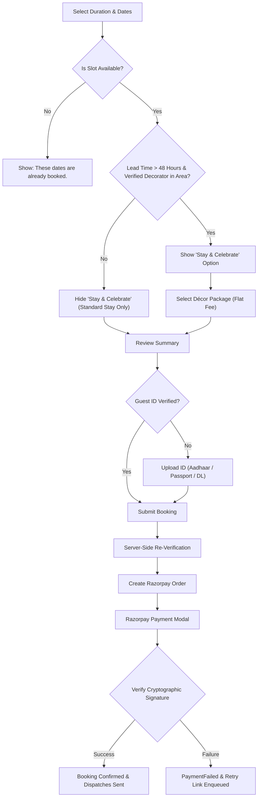

# Booking and Checkout Flow

## 1. Overview
The BookMyFun booking flow guides a guest from property duration selection through optional "Stay & Celebrate" décor packages, identity verification (KYC), and online payment via Razorpay.

The primary entry point is [`BookingController.cs`](file:///d:/Projects/BookMyFun/Controllers/BookingController.cs) action `Checkout` and Razor view [`Views/Booking/Checkout.cshtml`](file:///d:/Projects/BookMyFun/Views/Booking/Checkout.cshtml).

---

## 2. Step-by-Step Checkout Flow



---

### Step 1: Duration Type and Date Selection
Guests select one of three duration types:
1. **Full Day** (`FullDay`): Default. Requires `CheckInDate` and `CheckOutDate`. Stay nights calculated as `CheckOutDate - CheckInDate` (minimum 1 night).
2. **Half Day** (`HalfDay`): Same-day visit. Billed at `PricePerHalfDay`.
3. **Hourly** (`Hourly`): Requires selecting `HourlyDuration` (number of hours). Billed at `PricePerHour * HourlyDuration`.

### Step 2: Availability Rule
Availability is evaluated by `_bookingRepo.IsSlotAvailableAsync(propertyId, inDate, outDate, bookingType, hourlyDuration)`.
- If the requested dates overlap with an existing confirmed booking or blocked date, the slot is unavailable.
- Error message shown to guest: `"These dates are already booked."`
- The Stay & Celebrate toggle is not displayed when dates are unavailable.

---

### Step 3: Standard Stay vs. Stay & Celebrate

Guests choose between:
- **Standard Stay**: Default option. Accommodates standard lodging without décor add-ons.
- **Stay & Celebrate**: Adds curated event styling and décor packages to the stay.

#### Visibility Eligibility Rules
The "Stay & Celebrate" option is displayed **only when both criteria are met**:
1. **The 48-Hour Lead Time Rule**:
   - Check-in datetime must be strictly more than 48 hours after current time in Asia/Kolkata (`India Standard Time`, UTC+05:30).
   - Exactly 48 hours is not allowed (`checkInDateTime > nowIst.AddHours(48)`).
   - Check-in datetime is calculated from `CheckInDate` and the property's `CheckInTime` (defaults to `12:00:00` if not set).
2. **Active Area Coverage Rule**:
   - At least one active, verified event manager (`VerificationStatus == 'Verified'`) must have a service area covering the property's `City` and `State`.

If either condition fails, the option is **completely hidden** (not disabled or greyed out).

#### Dynamic Date Change Handling
- On initial page load and whenever the check-in or check-out date changes, the page queries the eligibility endpoint:
  ```http
  GET /Booking/CelebrationEligibility?propertyId={id}&checkIn={YYYY-MM-DD}&checkOut={YYYY-MM-DD}&checkInTime={HH:mm}
  ```
- If the guest had "Stay & Celebrate" selected and changes the date to within 48 hours, the form automatically resets to "Standard Stay" and displays:
  > *"Décor needs more than 48 hours' notice, so we've switched you to a standard stay."*

---

### Step 4: Décor Package Selection Menu
When "Stay & Celebrate" is selected, the menu displays elements in the following sequence:

1. **Occasion Chips**:
   - Filters packages by occasion: `Birthday Party`, `Anniversary`, `Wedding / Reception`, `Corporate / Offsite`, `Custom Gathering`.
   - Only categories that have at least one active package in the property's area are displayed.
2. **Manager Cards**:
   - Each card displays: Studio Brand Name, Verified Badge, Rating, Events Completed, Package Name, and Package Price.
   - Includes a "View profile" link opening `/EventManager/PublicProfile/{id}` in a new tab.
   - **Privacy Rule**: Direct phone numbers, emails, WhatsApp links, and external social media links are strictly omitted.
3. **Sort Toggle**:
   - Allows guests to sort packages by:
     - **Top rated** (default)
     - **Lowest price**
4. **"You Might Also Like" Fallback**:
   - If the selected occasion has no packages in that location, the system presents 3 to 7 packages from other categories in the same area.
   - Each card identifies its occasion category.
5. **Summary Pricing**:
   - **Stay Total**: Property rate based on duration.
   - **Décor Fee**: Single flat fee per reservation (never multiplied by number of nights).
   - **Total**: Sum of stay total, flat décor fee, platform fee, taxes, and refundable security deposit.

---

### Step 5: Identity Verification (KYC Gate)
Before submitting a reservation, guests must satisfy KYC requirements:
- If the guest has a prior `Verified` document on file in `ClientIdVerifications`, no new upload is required.
- If not verified, the guest must:
  1. Select a document type (`Aadhaar`, `Passport`, or `DrivingLicense`).
  2. Upload a clear document image (`IdDocument`).
- Uploaded documents are saved to private storage (`/App_Data/PrivateDocuments/`) and registered in `ClientIdVerifications` with status `PendingReview`.

---

### Step 6: Server-Side Checks on Submission
When the booking form is posted to `POST /Booking/Checkout`, the server re-validates all client parameters:
1. **Authentication**: User must be signed in as `Client` or `Admin`.
2. **Date Availability**: Verifies that dates are still available to prevent double-booking race conditions.
3. **48-Hour Lead Time**: Recalculates check-in lead time in Asia/Kolkata timezone. Rejects with error if under 48 hours.
4. **Package Authorization**:
   - Loads package directly from database via `_packageRepo.GetPackageByIdAsync(packageId)`.
   - Confirms package is active and belongs to a verified event manager.
   - Confirms event manager serves the property's city and state.
   - **Price Integrity**: Uses the server package price. Any price submitted in form fields is ignored.
5. **Calculation**: Recalculates platform fee, tax, security deposit, and host/decorator earnings splits.

---

### Step 7: Payment and Confirmation
1. **Order Creation**:
   - Booking record created with `Status = "Pending"`.
   - Razorpay order created via `_paymentService.CreateOrderAsync(totalAmount, $"booking_{bookingId}")`.
2. **Payment Page**:
   - Guest is redirected to `/Booking/Payment/{bookingId}` displaying the Razorpay checkout interface.
3. **Signature Verification**:
   - Razorpay returns payment payload to `/Booking/VerifyPayment`: `razorpay_order_id`, `razorpay_payment_id`, and `razorpay_signature`.
   - Server computes cryptographic HMAC SHA256 signature using the configured API secret.
4. **Payment Outcomes**:
   - **Valid Signature**:
     - `Payments` table records status `Success` with transaction reference `RAZORPAY_{payment_id}`.
     - `Bookings` table status updated to `Confirmed`.
     - Outbound notifications dispatched to Client, Host, Decorator, and Staff.
     - Guest redirected to `/Booking/Confirmation/{bookingId}`.
   - **Signature Verification Failed**:
     - Booking marked as `PaymentFailed`.
     - Error handler triggers `OnPaymentFailedAsync`.
     - Guest redirected to payment retry page with error message.
5. **Webhook Fallback**:
   - [`RazorpayWebhookController.cs`](file:///d:/Projects/BookMyFun/Controllers/RazorpayWebhookController.cs) (`/api/webhooks/razorpay` and `/webhook/razorpay`) processes asynchronous `order.paid` webhooks from Razorpay to guarantee booking confirmation if the guest disconnects before redirect.
