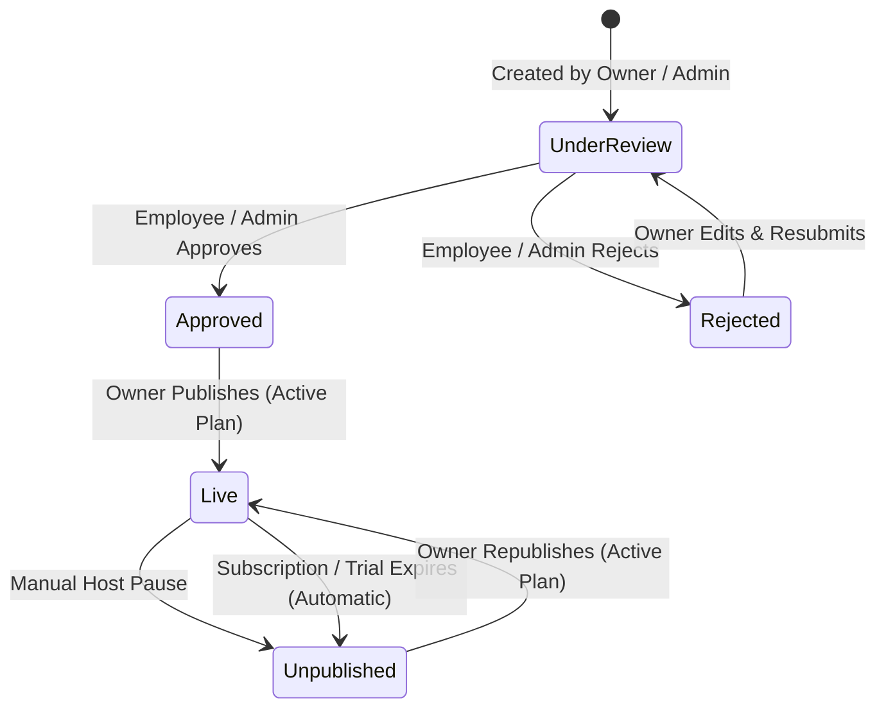

# Property Listing Lifecycle and Subscription Rules

## 1. Overview
BookMyFun regulates the lifecycle of property listings to maintain quality and safety. Every listing transitions through explicit lifecycle states tracked in the [`Properties`](file:///d:/Projects/BookMyFun/Docs/database.md#properties) table (`ListingStatus`, `IsApproved`, `IsActive`).

Active public visibility is strictly linked to the host's subscription plan and listing capacity.

---

## 2. Listing Lifecycle States

### 2.1 State Definitions

| State (`ListingStatus`) | `IsApproved` | Public Search Visibility | Description | Permitted Transition Actors |
|:---|:---:|:---:|:---|:---|
| `UnderReview` | `0` | Hidden | New submission awaiting moderation review. | Owner, Admin |
| `Approved` | `1` | Hidden | Reviewed and verified by staff. Ready for the host to publish. | Employee, Admin |
| `Live` | `1` | **Visible** | Active in public search catalog and available for bookings. | Owner (requires valid plan), Admin |
| `Unpublished` | `1` | Hidden | Deactivated by host, paused for maintenance, or unpublished due to expired subscription. | Owner, Admin, Background Service |
| `Rejected` | `0` | Hidden | Declined by moderation team. Requires host revision before resubmission. | Employee, Admin |

---

## 3. Roles and Permissions for Listing Transitions

- **Create Listing**:
  - `Owner` creates listings via `/Owner/CreateProperty`. Status defaults to `UnderReview` (`IsApproved = 0`).
  - `Admin` can create listings on behalf of hosts via `/Admin/CreateProperty`.
- **Approve Listing**:
  - `Employee` and `Admin` review listings in verification queues (`/Employee/ManageProperties` or `/Admin/ManageProperties`).
  - Approving sets `IsApproved = 1`, `ListingStatus = "Approved"`, `ApprovedAt = GETDATE()`, and records `ApprovedByUserID`.
  - Sends `DispatchPropertyApprovedAsync` notification to the host.
- **Reject Listing**:
  - `Employee` and `Admin` can reject listings. A mandatory text explanation (`reason`) is required.
  - Sets `IsApproved = 0`, `ListingStatus = "Rejected"`, and records `UnpublishReason`.
  - Sends `DispatchPropertyRejectedAsync` notification with reason to host.
- **Publish Listing (Go Live)**:
  - `Owner` clicks "Publish" in `/Owner/Index`.
  - Allowed only if `IsApproved == 1` and host has an active subscription with unused listing capacity (`ActivePropertiesCount < Plan.MaxListings`).
  - Sets `ListingStatus = "Live"` and `PublishedAt = GETDATE()`.
- **Unpublish Listing**:
  - `Owner` can pause/unpublish their property at any time via `/Owner/Index`.
  - Automatic system unpublish is triggered by the subscription background worker upon plan expiry.

---

## 4. Host Trial and Subscription Rules

Host listing privileges are governed by [`SubscriptionPlans`](file:///d:/Projects/BookMyFun/Docs/database.md#subscriptionplans) and [`OwnerSubscriptions`](file:///d:/Projects/BookMyFun/Docs/database.md#ownersubscriptions).

### 4.1 60-Day Free Trial
- When an owner application or partner lead is approved by staff, the host receives a complimentary **60-day Free Trial** (`trialDurationDays = 60`).
- The trial allows hosting up to **1 active live listing** (`MaxListings = 1`).
- `Properties.TrialEndsAt` records the expiration date.

### 4.2 Paid Subscription Plans
Hosts upgrade to paid tiers to list multiple properties:
- **Starter Plan**: Accommodates 1 to 3 live properties.
- **Growth Plan**: Accommodates 5 to 10 live properties.
- **Premium Plan**: Unlimited listings with featured badge placement.
- Supported billing cycles: `Monthly`, `Quarterly`, `Yearly`.

---

## 5. Automated Lifecycle Background Processing

The [`SubscriptionLifecycleBackgroundService.cs`](file:///d:/Projects/BookMyFun/Services/Notifications/SubscriptionLifecycleBackgroundService.cs) runs continuously on an hourly schedule:

### 5.1 3-Day Advance Expiry Warnings
- Queries subscriptions expiring within 72 hours (`GetExpiringSubscriptionsAsync(3)`).
- If trial: dispatches `DispatchTrialExpiringWarningAsync`.
- If paid: dispatches `DispatchSubscriptionExpiringWarningAsync`.

### 5.2 Unpublish-on-Expiry (Zero Grace Period)
- Detects expired subscriptions where `EndDate <= GETDATE()`.
- Calls `BatchUnpublishPropertiesByOwnerIdAsync(ownerId, "Subscription expired")`.
- All live properties of that host are moved to `ListingStatus = "Unpublished"`.
- Dispatches `DispatchSubscriptionExpiredAsync` alert to host with renewal instructions.

### 5.3 Auto-Republish After Renewal
- When a host renews their subscription or purchases a new plan:
  - `RepublishExpiredPropertiesAsync(ownerId, maxListings)` automatically restores previously unpublished listings to `Live` status up to the plan's listing allowance.
  - Dispatches `DispatchSubscriptionActivatedAsync` listing the reinstated properties.

### 5.4 Scheduled Upgrades
- If an owner with an active subscription purchases another plan in advance, the new plan is stored with status `Scheduled` and starts at `currentSubscription.EndDate`.
- Once the active subscription concludes, the background service transitions the scheduled subscription to `Active` and updates listing capacities.
